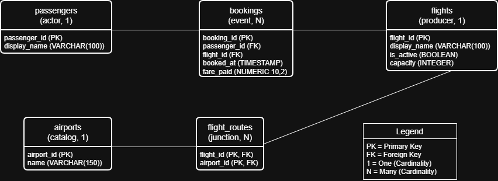

# Airline Booking Database: SQL Analysis of Booking Failures

**Om Pandey** | EX 603 | PostgreSQL

A relational model of an airline booking platform and a set of SQL analyses that test a dashboard's claim that "half of all bookings fail", find which flights actually have a problem, and show whether the platform is getting better or worse.

## The Domain

**Theme: Airline Booking.** The platform lets passengers book flights, and it records which airports each flight serves. Mapped to the course's roles: flights are the *producers*, passengers are the *actors*, bookings are the *events*, airports are the *catalog* and `flight_routes` is the *junction* between flights and airports.

The platform has to answer operational questions: which flights receive the most bookings, how much fare revenue has been generated, which bookings were cancelled and why, and which flights are connected to which airports. The design also has to keep historical bookings, so that past activity can still be analyzed after a flight stops being active.

The analysis started from a practical problem. A dashboard showed that about half of all bookings ended as a passenger no-show, and a route profitability payout was frozen because of it. The queries here check that number against the booking records, split the real failure rate by flight, look for flights that other reports miss, and finally ask whether the problem is getting better or worse over time. The final recommendation for the next quarter is in [analysis/unit6-finding.md](analysis/unit6-finding.md).

## Database Overview



The schema is defined in [schema/schema.sql](schema/schema.sql), with the reasoning in [schema/schema-definition.md](schema/schema-definition.md) and [schema/constraints.md](schema/constraints.md). From Unit 3 onward the queries run on the course dataset `ex603_data`, which uses the same five tables with extra columns used in the analysis (for example `booking_status`, `cancellation_reason`, `booking_country`, `seat_capacity`). The tables the analysis relies on:

| Table | Role | What the analysis uses it for |
|---|---|---|
| `bookings` | Events (200 rows) | `fare_paid`, `booked_at`, `booking_status` (confirmed, cancelled, disputed) and `cancellation_reason`. A failure is a booking with status `cancelled`. |
| `flights` | Producers (15 rows) | The unit being compared: failure rate, volume and activity per flight, using `is_active` and `seat_capacity`. |
| `passengers` | Actors | Who is behind the bookings (Units 3 and 5). |
| `airports` | Catalog | Descriptive data about the places flights serve. |
| `flight_routes` | Junction | Links flights to airports many-to-many; its composite key `(flight_id, airport_id)` stops duplicate links. |

`bookings` uses `ON DELETE RESTRICT` toward `passengers` and `flights`, so booking history cannot be removed by deleting a flight or a passenger.

## Query Catalogue

Every `.sql` file starts with a header comment naming the task and the question it answers. Write-ups are in [analysis/](analysis/) and screenshots of results are in [screenshots/](screenshots/).

### Unit 3: Establish what the data contains

| File | Business question |
|---|---|
| [q3_1.sql](queries/unit3/q3_1.sql) | What do the booking records contain: which statuses and cancellation reasons exist, and how do I describe bookings in plain language? |
| [q3_2.sql](queries/unit3/q3_2.sql) | Why did a "not a no-show" filter silently drop 166 bookings, and why does a column alias fail in `WHERE`? |
| [q3_3.sql](queries/unit3/q3_3.sql) | Which passengers were involved in disputed bookings, written three equivalent ways and proven identical? |

### Unit 4: Aggregation

| File | Business question |
|---|---|
| [q4_1.sql](queries/unit4/q4_1.sql) | What are the platform's booking counts and fare statistics, per flight, and which flights have enough volume to trust? |
| [q4_2.sql](queries/unit4/q4_2.sql) | What is the failure rate per flight, per booking country, and as a baseline across high-volume flights? |

### Unit 5: Joins

| File | Business question |
|---|---|
| [q5_1.sql](queries/unit5/q5_1.sql) | Who is behind each booking, and do the flagged flights share airports? |
| [q5_2.sql](queries/unit5/q5_2.sql) | Which flights have no bookings and so vanish from an inner-join report? |
| [q5_3.sql](queries/unit5/q5_3.sql) | How does PostgreSQL plan and execute the three-table join? |

### Unit 6: Window functions

| File | Business question |
|---|---|
| [q6_1.sql](queries/unit6/q6_1.sql) | Is a booking unusual for its own flight? How do flights rank by volume when they tie, and how do they fall into four bands? |
| [q6_2.sql](queries/unit6/q6_2.sql) | Is a flight's fare trend going up or down? How is the platform doing against a target? Where does a flight's series go quiet, and why? |
| [q6_3.sql](queries/unit6/q6_3.sql) | What are the top three bookings per flight? Is the failure rate getting better or worse by month and by quarter? |

## Technical Highlights

1. **Conditional aggregation (Unit 4).** `COUNT(*)` and `SUM(CASE WHEN booking_status = 'cancelled' ...)` in one pass gave the total and the failures from the same rows, so the rate cannot disagree with itself. `ROLLUP` added regional subtotals and a platform total without detail rows.
2. **NULL-safe logic and proof of equivalence (Unit 3).** A filter written as `!= 'Passenger no show'` quietly dropped 166 bookings with no reason. Fixing it with `IS NULL` and then proving three subquery forms return identical rows with `EXCEPT` and hash fingerprints showed the repair was complete, not just plausible.
3. **Outer joins and anti-joins for what is missing (Unit 5).** `LEFT JOIN`, `NOT EXISTS` and `EXCEPT` found flights with no bookings, which an inner join hides. A report that only lists flights with bookings overstates how well the platform is doing.
4. **Window functions that keep rows (Unit 6).** `AVG() OVER (PARTITION BY ...)` put each booking next to its flight's average without losing the booking. `ROW_NUMBER`, `RANK` and `DENSE_RANK` side by side showed how tie handling changes a leaderboard: Flights 2 and 11 tie on 16 bookings, and each function treats them differently.
5. **Time series with `LAG`, calendar tables and gap checks (Unit 6).** `generate_series` built a full day and month calendar, so a 7-row window means exactly 7 days and missing months are visible. `LAG` computed month-over-month and quarter-over-quarter change, with `NULLIF` against division by zero, and a CTE separated finding gaps from filtering them.

## Findings and Recommendations

1. **The dashboard's "half of bookings fail" was wrong.** Of 200 bookings, 34 (17.0%) were cancelled, and only 12 (6%) were passenger no-shows. Even counting 10 disputed bookings the figure is 22%. *Recommendation:* lift the payout freeze and have the dashboard team send their original query ([analysis/unit3-finding.md](analysis/unit3-finding.md)).
2. **A few flights, not the whole platform, have a failure problem.** Flights 11, 2 and 6 fail at 31.3%, 25.0% and 19.0% against a 15.2% baseline, and each needs a different response (flight cancellations, no-shows, scheduling). Separately, Flights 14 and 15 have never been booked, and Flight 9 went 113 days without a booking while other flights kept booking. *Recommendation:* review the flagged flights booking by booking, and ask scheduling what Flight 9, 14 and 15 are for ([analysis/unit4-finding.md](analysis/unit4-finding.md), [analysis/unit5-finding.md](analysis/unit5-finding.md)).
3. **The failure rate looks stable to slightly better, not worse.** By quarter it was 22.6%, 14.6%, 15.7% and 14.6% in 2023. Single months swing from 0% to 27% on about 17 bookings, so I judge the trend by quarter. *Recommendation:* report rates with booking counts, and re-check by quarter next quarter ([analysis/unit6-finding.md](analysis/unit6-finding.md)).

## Limitations and Future Improvements

The biggest limitation is volume: 200 bookings across 15 flights and 12 months is about 17 bookings a month, so one cancellation moves a monthly rate by about 6 points and the improvement from Q1 to Q2 cannot be called proven. A related gap is that `booked_at` records when a booking was made, not when the passenger was due to fly, so failures cannot be tied to travel dates or seasons. More history, or a departure date on each booking, would allow confidence intervals on the rates and a proper check of whether the apparent improvement is real.

## Video Presentation

*Link to be added.*

## How to Run

You need PostgreSQL 14 or later and a database to work in.

```bash
# 1. Create a database and the schema
createdb ex603_data
psql -d ex603_data -f schema/schema.sql

# 2. Run any query file
psql -d ex603_data -f queries/unit6/q6_1.sql
```

`schema/schema.sql` creates the five empty tables. The queries from Unit 3 onward expect the Unit 3 course dataset loaded into `ex603_data` (200 bookings, 15 flights, with the extra analysis columns). That dataset comes from the course and is not reproduced here, so load it before running those queries.

In pgAdmin instead, open the Query Tool on the `ex603_data` database, paste or open a `.sql` file, then highlight one query and press F5 to run just that query, or press F5 with nothing highlighted to run the whole file.
