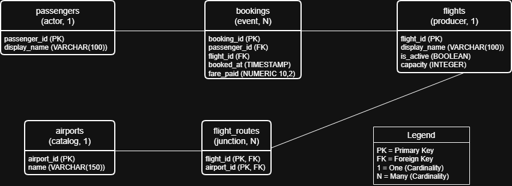

# ex603-airline-booking-database
## Om Pandey
## Airline Booking

A relational database design for an airline booking platform that records passengers, flights, bookings, airports, and flight routes.

## Domain

**Theme: Airline Booking**

This project models an airline booking platform where passengers can book flights and where the system maintains information about available flights and the airports associated with their routes. The database is designed to support both operational booking activity and later analytical queries.

The platform needs to answer questions such as which passengers have made bookings, which flights receive the most bookings, how much fare revenue has been generated, which flights are active, and which airports are associated with particular flights. The design also needs to preserve historical booking information so that past activity can be analyzed even when a flight is no longer active.

## Schema

The database consists of five relations:

* **Passengers** - the actors who make bookings.
* **Flights** - the supply-side entities that passengers can book.
* **Bookings** - the high-volume event table recording booking activity.
* **Airports** - the descriptive catalog of airports.
* **Flight Routes** - the junction relation connecting flights and airports through a many-to-many relationship.

The schema uses primary keys to provide stable identifiers and foreign keys to maintain valid relationships. Historical bookings are protected from accidental deletion by using restrictive foreign-key behavior, while dependent route records can be removed with their parent flight when appropriate.

### Entity Relationship Diagram

## Query Catalogue

-- 4.1a Q: Across all bookings, what are the count, total, average, min and max fare,
--    and how many distinct passengers appear? (Aggregate functions)
SELECT COUNT(*)                     AS booking_count,
       SUM(fare_paid)               AS total_fare,
       ROUND(AVG(fare_paid), 2)     AS avg_fare,
       MIN(fare_paid)               AS min_fare,
       MAX(fare_paid)               AS max_fare,
       COUNT(DISTINCT passenger_id) AS distinct_passengers
FROM   bookings;

-- 4.1a-check Q: The minimum is 0.00. Is every zero fare a cancelled booking?
SELECT booking_status,
       COUNT(*)                                AS bookings,
       COUNT(*) FILTER (WHERE fare_paid = 0)   AS zero_fare_rows,
       ROUND(AVG(fare_paid), 2)                AS avg_fare
FROM   bookings
GROUP BY booking_status
ORDER BY bookings DESC;

-- 4.1b Q: For each flight, how many bookings and what average fare, busiest first? (GROUP BY)
SELECT flight_id,
       COUNT(*)                 AS bookings,
       ROUND(AVG(fare_paid), 2) AS avg_fare
FROM   bookings
GROUP BY flight_id
ORDER BY bookings DESC, flight_id;

-- 4.1c Q: Which flights have enough bookings for their numbers to mean something? (HAVING)
--    Threshold 15: flights below it have ~11 or fewer bookings, so one cancellation
--    swings their rate by 9+ points.
SELECT flight_id,
       COUNT(*)                 AS bookings,
       ROUND(AVG(fare_paid), 2) AS avg_fare
FROM   bookings
GROUP BY flight_id
HAVING COUNT(*) >= 15
ORDER BY bookings DESC, flight_id;

-- 4.1d Q: How does performance vary by booking country AND flight? (two-dimension GROUP BY)
SELECT booking_country,
       flight_id,
       COUNT(*)                                              AS bookings,
       COUNT(*) FILTER (WHERE booking_status = 'cancelled')  AS cancelled,
       ROUND(AVG(fare_paid), 2)                              AS avg_fare
FROM   bookings
GROUP BY booking_country, flight_id
ORDER BY booking_country, flight_id;

-- 4.2a Q: For each flight, how many bookings in total and how many failures,
--    in one pass with no WHERE clause? (CASE inside aggregate)
SELECT flight_id,
       COUNT(*)                                                  AS total_bookings,
       SUM(CASE WHEN booking_status = 'cancelled' THEN 1 ELSE 0 END) AS failed_bookings,
       ROUND(100.0 * SUM(CASE WHEN booking_status = 'cancelled' THEN 1 ELSE 0 END)
             / COUNT(*), 1)                                      AS failure_rate_pct
FROM   bookings
GROUP BY flight_id
ORDER BY failure_rate_pct DESC, flight_id;

-- 4.2b Q: What are the failure counts per region, plus a platform grand total,
--    without detail rows? (ROLLUP)
--    Rows with a country = regional subtotals; the row labelled 'PLATFORM TOTAL' = grand total.
SELECT CASE WHEN GROUPING(booking_country) = 1 THEN 'PLATFORM TOTAL'
            ELSE booking_country END                              AS region,
       COUNT(*)                                                   AS total_bookings,
       SUM(CASE WHEN booking_status = 'cancelled' THEN 1 ELSE 0 END) AS failed_bookings,
       ROUND(100.0 * SUM(CASE WHEN booking_status = 'cancelled' THEN 1 ELSE 0 END)
             / COUNT(*), 1)                                       AS failure_rate_pct
FROM   bookings
GROUP BY ROLLUP (booking_country)
ORDER BY GROUPING(booking_country), booking_country;

-- 4.2c Q: Among high-volume flights (15+ bookings), what is the baseline failure rate? (CTE pipeline)
WITH per_flight AS (
    SELECT flight_id,
           COUNT(*) AS bookings,
           SUM(CASE WHEN booking_status = 'cancelled' THEN 1 ELSE 0 END) AS failures
    FROM   bookings
    GROUP BY flight_id
)
SELECT COUNT(*)                                         AS high_volume_flights,
       ROUND(100.0 * SUM(failures) / SUM(bookings), 1)  AS pooled_failure_rate_pct,
       ROUND(AVG(100.0 * failures / bookings), 1)       AS avg_of_flight_rates_pct
FROM   per_flight
WHERE  bookings >= 15;

## Technical Highlights

The design currently focuses on:

* Relational normalization and separation of entity, event, and junction data.
* Stable primary keys for core entities.
* Composite primary keys for many-to-many relationships.
* Foreign keys to protect referential integrity.
* Database-level constraints for invalid capacities and fares.
* Preservation of historical booking data.

## What I Would Do Differently

This section will be expanded as the project develops and additional implementation and query requirements reveal strengths and weaknesses in the initial design.

## Video Presentation

The presentation link will be added in Unit 6.

## How to Run

To create a database, right click on databases under postgresql under servers, and click create and give the new database a name.

To execute a specific query, highlight any of that query and click the play/execute button, or press the F5 key. To execute the whole script, just click the play/execute button, or press the F5 key.

## Schema

These are the five tables the database models for an airline booking system:

* **`passengers`** - Stores passenger records. Each passenger has a generated integer primary key and a required display name.
* **`airports`** - Stores airport records with a generated integer primary key and required airport name.
* **`flights`** - Stores flight information, including a generated flight ID, display name, active/inactive status, and passenger capacity.
* **`bookings`** - Connects passengers to flights and records when the booking was made and the fare paid. Each booking references one passenger and one flight.
* **`flight_routes`** - Junction table connecting flights and airports. Its composite primary key `(flight_id, airport_id)` prevents the same flight-airport relationship from being recorded more than once.

### Design Decisions

The schema uses PostgreSQL 14+ identity columns (`GENERATED ALWAYS AS IDENTITY`) for surrogate primary keys. Foreign keys are created only after their referenced tables, so the schema can be executed from top to bottom without forward references.

The `bookings` table uses `ON DELETE RESTRICT` for both passengers and flights so that historical booking records cannot be accidentally removed when a referenced passenger or flight is deleted. The `flight_routes.flight_id` relationship uses `ON DELETE CASCADE` because route relationships are dependent on the flight they describe. The airport relationship uses `ON DELETE RESTRICT` to prevent an airport from being removed while it is still referenced by a route.

The `flight_routes` table uses a composite primary key rather than an additional surrogate ID because the combination of a flight and airport uniquely identifies each route relationship.

The schema also uses `CHECK` constraints to prevent invalid data. Flight capacity must be greater than zero, and a booking's `fare_paid` value cannot be negative. Monetary values use `NUMERIC(10,2)` rather than floating-point types to preserve exact decimal precision.
